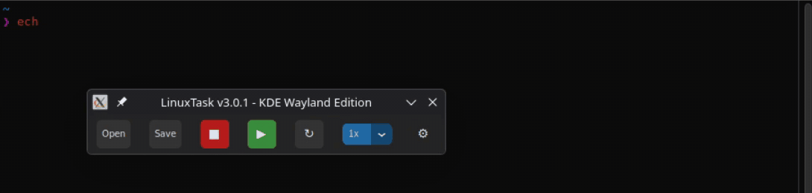
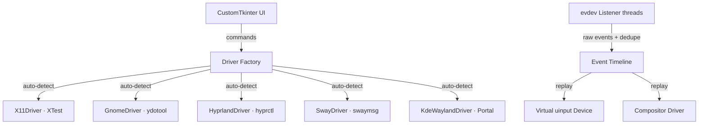

# LinuxTask — Macro Recorder for Linux

> 👤 More projects: [@JADRT22](https://github.com/JADRT22) — Hyprland automation • Roblox on Linux • MCP/agents

**A minimalist macro recorder for Linux — record and replay keyboard + mouse macros. Drivers exist for KDE Plasma Wayland, Hyprland, Sway, GNOME Wayland and X11 (see [Status](#status) below).**

[](https://github.com/JADRT22/LinuxTask/releases)
[](https://github.com/JADRT22/LinuxTask/actions/workflows/python-app.yml)
[](LICENSE)
[](https://github.com/JADRT22/LinuxTask/stargazers)

LinuxTask records and replays keyboard and mouse actions on X11 and Wayland.
Recording reads events directly from the kernel via `evdev`, so nothing is
lost even when the desktop is under load. Replay uses a virtual `uinput`
device or the native APIs of your compositor, which sidesteps the input
injection restrictions that Wayland compositors impose on traditional X11
automation tools.



## Copy-paste in 30s

```bash
git clone https://github.com/JADRT22/LinuxTask.git && cd LinuxTask && ./tools/install.sh && ./tools/run.sh
```

Or download
[LinuxTask-x86_64.AppImage](https://github.com/JADRT22/LinuxTask/releases/latest/download/LinuxTask-x86_64.AppImage),
`chmod +x` it and run — no clone, no venv (see [AppImage](#appimage)).

Record with **F8**, replay with **F9** — global hotkeys work in any window.

> 🇧🇷 **Em Português:** LinuxTask é um gravador de macros para Linux — grava e reproduz teclado e mouse no Hyprland, Sway, GNOME Wayland, KDE Wayland e X11, com captura via `evdev` e reprodução por `uinput`/APIs do compositor. Instalação: `./tools/install.sh`, uso: `./tools/run.sh` (atalhos globais F8/F9).

## Table of contents

- [Features](#features)
- [Status](#status)
  - [Known limitations](#known-limitations)
- [How it works](#how-it-works)
- [Getting started](#getting-started)
  - [Requirements](#requirements) · [Install](#install) · [Run](#run)
- [Usage](#usage)
- [Headless CLI](#headless-cli)
  - [Macro file format](#macro-file-format)
- [Security model](#security-model)
- [Development](#development)
  - [Tests](#tests) · [Release process](#release-process) · [AppImage](#appimage)
- [Troubleshooting](#troubleshooting)
- [FAQ](#faq)
- [Uninstall](#uninstall)
- [Contributing](#contributing)

## Features

- **Cross-desktop drivers** — native backends for X11 (Cinnamon, MATE, XFCE…),
  GNOME Wayland, Hyprland, Sway and KDE Wayland, auto-detected at startup.
- **Hardware-precision capture** — raw `evdev` event reading with
  deduplication across multiple input devices and `time.monotonic()`-based
  scheduling, immune to NTP and DST clock jumps.
- **Mouse support** — absolute and relative movement, button clicks and
  scroll wheel, with automatic fallback to the virtual `uinput` device when a
  compositor cannot handle an action. KDE Plasma Wayland and Hyprland are
  fully supported — record, replay and clicks verified by the author.
- **Humanize mode** — optional ±2 px positional jitter and 0–3 % timing
  variance so replays do not look machine-perfect.
- **Playback control** — 0.5×–10× speed, loop mode, stop-at-any-time.
- **Headless CLI** — `play <macro.json>` replays a macro from a script
  (`--speed`, `--loop`, `--humanize`) without opening a window.
- **Portable macros** — a single JSON file holding the event timeline and the
  starting cursor position.
- **Global hotkeys** — record and play from any window (F8/F9 by default,
  fully remappable).
- **Compact UI** — a 400×44 px toolbar built with CustomTkinter that stays out
  of the way.

## Status

This README describes v3.5.2 (`APP_VERSION` in `src/main.py`).

| Driver | Support level |
|---|---|
| KDE Plasma Wayland | **100% — fully tested by the author (CachyOS): record, replay and clicks** |
| Hyprland | **Tested by the author: record, replay and clicks** |
| GNOME Wayland | Implemented, not tested by the author — absolute mode needs the [cursor-bridge extension](#gnome-wayland-absolute-mode) |
| X11 desktops (Cinnamon, MATE, XFCE…) | **Tested by the author: record, replay and clicks** |
| Sway | **Tested by the author (headless 1.12): cursor warp, relative move, buttons and scroll via seat IPC** |

Implemented capability matrix (the Hyprland, KDE Plasma Wayland, Sway and X11 columns are tested by the author):

| | X11 desktops | GNOME Wayland | Hyprland | KDE Wayland | Sway |
|---|---|---|---|---|---|
| **Driver** | `python-xlib` (XTest) | `ydotool` + cursor-bridge ext. | `hyprctl` | XDG Portal (RemoteDesktop) | `swaymsg` (seat IPC) |
| Mouse click | ✅ | ✅ | ✅ (uinput) | ✅ (evdev button codes via the portal) | ✅ (`cursor press/release`) |
| Absolute move | ✅ | ✅ with the cursor-bridge extension, ❌ (emulated by deltas) without it | ✅ | ✅ (true position read from KWin, exact) | ⚠️ warp only — absolute *recording* is impossible (see below) |
| Relative move | ✅ | ✅ | ✅ | ✅ | ✅ |
| Scroll | ✅ | ✅ | ✅ (uinput) | ✅ | ✅ (`button4`/`button5`) |
| Keyboard | ✅ (uinput) | ✅ (uinput) | ✅ (uinput) | ✅ | ✅ (uinput) |

The driver is selected automatically from `XDG_CURRENT_DESKTOP`,
`XDG_SESSION_TYPE`, `HYPRLAND_INSTANCE_SIGNATURE` and `SWAYSOCK`; unsupported
desktops with a running X server fall back to the X11 driver.

> **Sway records relative motion.** The sway IPC can *warp* the cursor
> (`seat <seat> cursor set <x> <y>`, used at playback to honour a macro's
> `start_pos` and `pos` events) but it cannot *read* the position back — there
> is no equivalent of `get_seats` cursor data. So Sway records `rel` deltas,
> and macros recorded elsewhere still replay there through the uinput
> fallback. See [issue #4](https://github.com/JADRT22/LinuxTask/issues/4).

> **Note:** every cell marked `(uinput)` above needs a working `/dev/uinput`
> device. When it is missing, the app logs a warning (`"... dropped ...
> UInput unavailable"`) and that input is skipped during replay — keyboard
> and scroll do not silently fall back to anything else. The installer
> configures `/dev/uinput` access (see [Requirements](#requirements)).

### GNOME Wayland absolute mode

GNOME compositors do not publish the pointer position to clients, so a
traditional recorder cannot read the real cursor location (xdotool only
sees XWayland surfaces). LinuxTask solves this the same way its KDE
driver uses KWin scripting: a small **GNOME Shell extension** running
inside the shell exposes the pointer over D-Bus:

- `org.linuxtask.cursorbridge` / `/org/linuxtask/CursorBridge`, with
  `GetPointer()` (`global.get_pointer()`), `WarpPoint(x, y)`
  (`seat.warp_pointer()` — real absolute replay, no uinput) and
  `GetScreenSize()` (exact resolution, replacing the xrandr/mutter
  parsing).

The extension lives in `extensions/gnome-shell/` (GNOME 45+):

```bash
./tools/install-gnome-bridge.sh
```

Copy-install, enable, then **log out and back in once** — GNOME Shell
only picks up new extension files when the shell restarts. After that
it stays enabled and the driver starts with `supports_absolute_positioning`:

```bash
gdbus call --session --dest org.freedesktop.DBus \
  --object-path /org/freedesktop/DBus \
  --method org.freedesktop.DBus.NameHasOwner \
  org.linuxtask.cursorbridge   # must print '(true)'
```

Without the extension (or when it degrades), the driver keeps its
legacy behavior: relative deltas for playback, xdotool/tkinter for the
cursor read — the app shows a one-time dialog when it does. The
extension is silent on the lock screen (shell session mode), where
reads degrade to the fallback chain.

### Known limitations

- **KDE Plasma Wayland** needs `python3-dbus` and `python3-gi` from your
  distro repositories (they cannot be installed from PyPI).
- On first run the XDG Portal shows an authorization dialog; the driver
  waits up to 120 s for approval. If approval is denied or times out,
  cursor control stays disabled for that session.
- Screen resolution is read from `kscreen-doctor --json` (falling back to
  the `kscreen-doctor -o` listing, then `xrandr`, then 1920×1080). From the
  JSON listing the driver also takes **every** output's offset, so replayed
  coordinates are clamped to the whole layout instead of the first monitor.
- **Multi-monitor**: coordinates are clipped to the bounding box of the
  outputs the compositor reports (offsets included, so a monitor placed
  above or to the left of the primary one — negative origin — stays
  reachable). This works on Hyprland (`hyprctl monitors -j`), Sway
  (`swaymsg -t get_outputs`), KDE Wayland (`kscreen-doctor --json`, then
  `xrandr`) and X11 (the root window already spans the layout), and on
  GNOME Wayland **only** with the cursor-bridge extension, whose `GetLayout`
  call reports the monitor union. Anywhere the layout cannot be read —
  an older bridge on GNOME, a Plasma without `kscreen-doctor --json` — the
  box degrades to one output, and a macro recorded on a second monitor
  placed left/above the origin gets folded onto it. On KDE the `-o`
  listing is the last resort and carries no positions: the output it picks
  is the first one kscreen prints, not necessarily the primary.
  The detected geometry is logged at start-up
  (`Resolution (…): 2560x1440, layout 4480x1620+0-180`).
- Cursor position is read from the compositor itself (KWin's scripting
  D-Bus API, `workspace.cursorPos`) and falls back to `xdotool
  getmouselocation`, which only works over XWayland surfaces; if both
  fail the driver keeps its last known position and shows a one-time
  warning instead of silently recording stale coordinates.
- When the portal session is not ready or a portal mouse call fails, the
  driver logs a WARNING (once per reason) and the app shows a one-time
  dialog; the event falls back to `uinput` when available, otherwise it is
  skipped.
- **GNOME Wayland absolute mode** needs the cursor-bridge extension
  above (one-time logout/login on install). `python3-dbus` is optional
  for GNOME: when importable the bridge is called in-process, otherwise
  each call is a short-lived `gdbus` subprocess.
- **`src/cli.py` has an unreproduced crash.** One of 42 headless runs
  exited with SIGSEGV (`-11`) instead of `0`. Thirty further runs with
  `-X faulthandler` did not reproduce it and produced no traceback, so
  whether it happens during or after replay is still unknown.

Runtime fixes for dependency and permission problems live in
[Troubleshooting](#troubleshooting).

## How it works



- **Recording**: one listener thread per input device pushes keyboard, mouse
  and scroll events into a timeline. Motion is flushed on `EV_SYN` report
  boundaries — absolute coordinates when the driver supports them, relative
  deltas otherwise.
- **Playback**: the timeline is replayed at the chosen speed through the
  compositor driver first and the virtual `uinput` device as fallback, with
  optional humanize jitter applied per movement.
- **Hotkeys**: global F8/F9 presses are detected by the same evdev listeners
  and dispatched to the UI thread through a queue, keeping tkinter calls on
  the main thread.

## Getting started

### Requirements

- Python ≥ 3.10 with Tk
- `evdev`, `customtkinter`, `python-xlib` (installed by the setup script into
  the project venv at the pinned versions; the distro `python3-evdev` is only
  a fallback for the system Python). evdev 2.x requires Python ≥ 3.11, so on
  3.10 the setup script installs the pinned 1.9.x instead — the recorder
  supports both APIs, and that is the version the distro packages ship.
- **GNOME Wayland only**: a running `ydotoold` daemon; the
  [cursor-bridge extension](#gnome-wayland-absolute-mode) for absolute
  mode (`python3-dbus` optional — used in-process when present, `gdbus`
  otherwise)
- **KDE Wayland only**: `python3-dbus` and `python3-gi` from your distro
  repositories (they cannot be built from PyPI without C headers)
- **Sway only**: `swaymsg` in `PATH` (ships with `sway`/`swayfx`)
- Membership in the `input` group and access to `/dev/uinput`
  (the installer configures both)

### Install

```bash
git clone https://github.com/JADRT22/LinuxTask.git
cd LinuxTask
./tools/install.sh
./tools/install.sh --yes      # unattended (CI): skip the sudo confirmation
```

The canonical scripts live in `tools/` (`tools/install.sh`,
`tools/run.sh`); the root `install.sh`/`run.sh` are thin wrappers
that forward to them.

The installer works with `apt`, `pacman` and `dnf`, installs the Python
dependencies, writes the `udev` rules, grants immediate ACL access (no
logout needed in most cases) and creates a desktop entry.

### Run

```bash
./tools/run.sh
```

Or look for **LinuxTask** in your application menu.

## Usage

| Control | Action |
|---|---|
| `●` / `■` | Start / stop recording (default hotkey **F8**) |
| `▶` / `■` | Play / stop playback (default hotkey **F9**) |
| `↻` | Toggle loop playback |
| Speed menu | Playback speed from 0.5× to 10× |
| `⚙` | Settings: remap hotkeys (press `Esc` to cancel), enable Humanize |
| Open / Save | Load / store macros as JSON files |

Hotkeys work globally: press F8 or F9 in any application. Recorded macros
store the event timeline plus the starting cursor position, and playback
returns the cursor there first so repeats are deterministic.

To replay a macro from a script, cron job or CI, skip the window entirely:
see [Headless CLI](#headless-cli) below.

## Headless CLI

`play` replays a recorded macro without opening the window, so a script can
drive input:

```bash
./tools/run.sh play macro.json --speed 2 --loop --humanize
python src/cli.py play macro.json        # same, straight from the source tree
linuxtask play macro.json                # AppImage / installed console script
```

| Flag | Effect |
|---|---|
| `--speed N` | Playback speed multiplier (default `1.0`; the GUI offers 0.5-10) |
| `--start-pos X,Y` | Move the cursor to `X,Y` before replaying, overriding the macro's stored start position |
| `--loop` | Keep replaying until `Ctrl+C` |
| `--humanize` | Add +/-2 px jitter and 0-3 % timing variance |
| `-v`, `--verbose` | Debug logging |

`--start-pos` is what makes a *relative* macro repeatable: a relative macro
only reproduces when it starts where it started before. It is also a safety
net against drift.

The file is the same JSON the GUI saves. A bad path or an unsupported
desktop exits non-zero with a message on stderr instead of a traceback -
`2` for an invalid macro, `1` for an unsupported desktop, `130` on `Ctrl+C`.
The driver and the virtual `uinput` device are opened only *after* the file
validates, so a typo cannot pop a portal authorization dialog. The CLI reuses
`src/playback.py` verbatim - same replay code the toolbar runs.

### Macro file format

The file is plain JSON, so a script can generate or rewrite a macro instead of
recording it in the GUI first:

```json
{
  "start_pos": [400, 300],
  "events": [
    {"type": "pos",    "x": 400, "y": 300, "time": 0.0},
    {"type": "rel",    "dx": 20, "dy": 0, "time": 0.1},
    {"type": "scroll", "direction": "down", "clicks": 2, "time": 0.4},
    {"type": "key",    "code": 272, "val": 1, "time": 0.6},
    {"type": "key",    "code": 272, "val": 0, "time": 0.7}
  ]
}
```

| Field | Meaning |
|---|---|
| `start_pos` | Optional `[x, y]` the cursor is moved to before the events; `--start-pos` overrides it |
| `time` | Seconds from the start of the pass; drives the pacing, and is divided by `--speed`. Required |
| `pos` | Absolute move to `x`, `y` |
| `rel` | Relative move by `dx`, `dy` |
| `scroll` | `direction` is `up` or `down`; `clicks` defaults to `1` |
| `key` | evdev `code` with `val`: `1` press, `0` release. `BTN_*` (272/273/274 = left/right/middle) go through the driver, keyboard codes through the virtual device |

A bare JSON list is also accepted - legacy macros have no `start_pos`. Events
that fail validation are dropped with a warning on stderr, and a file with no
valid event exits `2`, so a malformed generated macro fails loudly instead of
replaying half of itself.

## Security model

Input capture only needs to *read* devices; it never writes to them. The
bundled `udev` rules therefore grant:

- `/dev/input/event*` — **read-only** (`0440` + matching read-only ACL):
  enough for recording, while withholding the full injection primitive that
  write access on real keyboards would give any process in the `input` group.
- `/dev/uinput` — read/write (`0660`): replay creates a *virtual* device, so
  injected events go through the kernel's sanctioned input path or through
  compositor APIs, never into your physical devices.

Before the first recording ever starts, the app warns that recording
captures *every* key pressed while it is on (including passwords typed
in other windows) and offers "Don't show again".

Found a way to break that model? Report it privately through
[SECURITY.md](SECURITY.md) instead of opening an issue.

## Development

### Tests

```bash
# Everything, headless:
.venv/bin/python -m pytest tests -q --timeout=120

# The same suites without pytest:
.venv/bin/python -m unittest discover -s tests -t .
```

Both commands run from the repo root and collect `tests/` as it is, so
adding a suite needs no CI edit. They need an interpreter that can
import `evdev`, `customtkinter` and `python-xlib` — the project `.venv`
created by `tools/install.sh` is one, and
`pip install -r requirements-dev.txt` adds pytest, pytest-cov,
pytest-timeout and ruff on top of it. Each suite prepends `src/` to
`sys.path` internally, so there is nothing to install first
(`PYTHONPATH=src` works too).

The suites are display- and hardware-independent: the flow suite
exercises recording, playback dispatch, macro validation and
persistence by instantiating the app without a display or a mainloop,
and every driver is tested against fakes of its IPC (subprocess output,
D-Bus replies) rather than a live session.

CI (`.github/workflows/python-app.yml`) runs four jobs:

| Job | What it proves |
|---|---|
| `test` | pytest with coverage on 3.10/3.11/3.12/3.13/3.14, then `unittest discover`, so the documented no-pytest path cannot rot |
| `distro-bindings` | the same suite inside a `--system-site-packages` venv with `python3-dbus`, `python3-gi`, `python3-numpy`, `python3-pil` from apt — the only job where `tests/test_kde_wayland.py` and `tests/test_experimental_addons.py` really run |
| `lint` | `python -m ruff check .`, rules and exemptions in `pyproject.toml` |
| `appimage` | `tools/appimage/build.sh` end to end on a clean `ubuntu-latest` runner — the one place where `build/appimage/` holds nothing left over from an earlier build — then checks the bundle exists at the path the release job attaches from, so packaging breakage lands on the commit that caused it instead of at release time |

Suites that need distro bindings skip themselves when those modules are
missing, which is why the `test` job stays green without them — on a
machine that should have them, that skip means a missing package.
`.quarantine/tests/test_evdev_access.py` needs real hardware and is not
collected at all.

Three suites guard the packaging, because an AppImage-only breakage is
otherwise invisible until a twenty-minute build dies at the end:
`tests/test_appimage_smoke_coverage.py` reads `tools/appimage/build.sh`
and fails when a driver module under `src/drivers/` is missing from the
smoke guard's import list (the Sway driver shipped unimported in 3.1.x);
`tests/test_appimage_ui_patch.py` checks every staging rewrite anchor
against the real `src/main.py`; `tests/test_python_lock.py` checks the
interpreter pin against `tools/appimage/build.sh` and
`tools/appimage/pyproject.toml`.

### Release process

```bash
python3 tools/release.py --bump minor [--dry-run]
git push origin main --tags
```

The script bumps `APP_VERSION` (mirrored to the AppImage project), moves the
hand-written `[Unreleased]` notes under the new version heading (or uses a
generated draft from the commit list when `[Unreleased]` is empty), resets
`[Unreleased]` to empty, and maintains the footer link refs (`[Unreleased]`
retargeted to the new version, new `[vX]` ref inserted), commits and tags. Pushing a `v*` tag triggers the
GitHub Actions workflow that publishes the release with the changelog entry
as notes. `--dry-run` prints the exact `[vX.Y.Z]` section and footer link
refs that would be written (including the drained `[Unreleased]` body)
without touching any files.

### AppImage

Prebuilt for x86_64:
[LinuxTask-x86_64.AppImage](https://github.com/JADRT22/LinuxTask/releases/download/v3.5.2/LinuxTask-x86_64.AppImage)
from the [latest release](https://github.com/JADRT22/LinuxTask/releases/latest) —
`chmod +x` and run it; the udev rule and the GNOME bridge still need
`tools/install.sh` or the manual fallback below.

```bash
tools/appimage/build.sh
```

Builds an AppImage on top of python-build-standalone. The bundled
interpreter is pinned in `tools/appimage/python-build-standalone.lock`
(release tag + SHA-256) and `build.sh` verifies the download against that
digest before using it, so two builds of one commit ship one CPython —
the wheels are source-built against that same archive. Moving to a newer
interpreter is an explicit act:

```bash
python3 tools/appimage/update_python_lock.py --write   # then rebuild
```

and the regenerated lock is committed with whatever needs it. `tests/test_python_lock.py`
keeps the lock, the build script and `[tool.appimage] python` in agreement.

Note: the bundled python-build-standalone Tk is compiled without
fontconfig/Xft, so it only knows bitmap fonts — the AppImage toolbar shows
ASCII text labels (REC/PLAY/LOOP/SET/STOP) instead of the glyph icons, by
design. A source install via `tools/run.sh` uses the system fonts and the
original glyph labels; the GUI is otherwise identical.

## Troubleshooting

| Symptom | Fix |
|---|---|
| `Permission denied` on start | Re-run `./tools/install.sh` to refresh `udev` rules and group membership |
| Cursor does not move | Check the driver's external dependency: `ydotool` daemon running (GNOME Wayland), `hyprctl` in `PATH` (Hyprland), `swaymsg` in `PATH` (Sway), portal permission granted (KDE Wayland) |
| Hotkeys do not fire | Verify the `input` group: `groups $USER` — re-login after being added |
| Missing dependency dialog | Follow the printed instructions (`python-xlib` via pip; `python3-dbus`/`python3-gi` via your package manager) |
| GNOME: macros drift / "Absolute move emulated by relative delta" dialog | Install the cursor-bridge extension: `./tools/install-gnome-bridge.sh`, then log out and back in once. Check with the `gdbus NameHasOwner` call in [GNOME Wayland absolute mode](#gnome-wayland-absolute-mode) |
| Clicks land on the wrong monitor, or a macro recorded on a second screen stops reaching it | The clamp box is the layout the compositor reports. Read the start-up line in the log (`linuxtask` prints `layout WxH+X+Y`); if it names only one output, LinuxTask could not enumerate them — on GNOME update and re-install the cursor-bridge extension (older versions have no `GetLayout`), on KDE check that `kscreen-doctor --json` works, on Hyprland/Sway that `hyprctl monitors -j` / `swaymsg -t get_outputs` report the offsets. `--start-pos` in the CLI is the workaround when the layout is unreadable |

## Uninstall

```bash
./tools/uninstall.sh            # interactive (asks before leaving the input group)
./tools/uninstall.sh --yes      # skip the prompts
./tools/uninstall.sh --purge    # also force-remove shared pip packages
```

The root `./uninstall.sh` is a thin wrapper that forwards to `./tools/uninstall.sh` with the same flags (like `install.sh`/`run.sh`).

It is idempotent: re-running it is safe, and anything already gone is
reported as a warning. It removes the udev rule (plus reload), the
desktop entry, the `input` group membership, project-venv pip packages
and the temporary device ACLs — then prints what it deliberately keeps
(the project venv and the distro packages) with the command to remove
those by hand.

### Manual fallback

To revert what `tools/install.sh` does by hand:

```bash
# 1. Remove the udev rule and reload
sudo rm /etc/udev/rules.d/99-linuxtask.rules
sudo udevadm control --reload-rules && sudo udevadm trigger

# 2. Remove the desktop entry
rm ~/.local/share/applications/linuxtask.desktop
update-desktop-database ~/.local/share/applications

# 3. Remove yourself from the input group (optional)
sudo gpasswd -d "$USER" input

# 4. Remove the Python packages (only if nothing else needs them)
pip3 uninstall -y customtkinter evdev python-xlib

# 5. Optionally remove the distro packages the installer pulled in
# (xdotool, python3-dbus/python-dbus, python3-gi/python-gobject, acl)
# with your package manager, e.g.: sudo pacman -Rns xdotool
```

Note: the temporary ACLs on `/dev/uinput` and `/dev/input/event*`
disappear on reboot (`/dev` is in-memory); removing the udev rule is
what makes the change permanent.

## FAQ

**Does LinuxTask capture passwords?**
Only while a recording is on — recording reads *every* key pressed in
*any* window, including passwords typed outside the app. Before the
first recording ever starts, LinuxTask shows a warning about exactly
this and offers "Don't show again". Replayed macros contain only what
was recorded into the macro file; nothing is written outside it (see
[Security model](#security-model)).

**Will a macro recorded on one desktop replay on another?**
Yes — the macro is a plain JSON timeline, so it carries over. One
caveat: on [Sway](#status) the compositor cannot report the absolute
cursor position, so macros recorded there store *relative* deltas; a
relative macro only repeats reliably when it starts where it started
before. GNOME Wayland without the cursor-bridge extension has the same
limitation — installing it (`tools/install-gnome-bridge.sh`) switches
recording to real absolute coordinates; `play --start-pos X,Y` pins
that start point either way (see [Headless CLI](#headless-cli)).

**Can a script drive playback without the GUI?**
Yes. `play macro.json` replays any saved macro headlessly, with
`--speed`, `--loop`, `--humanize` and `--start-pos`, and the macro
format is documented JSON that a script can also *generate* instead of
recording it in the GUI (see [Macro file format](#macro-file-format)).

**Does it work on GNOME or KDE running X11?**
Yes. When the session type is `x11`, the GNOME and KDE branches of the
auto-detection use the X11 (XTest) driver directly, like any other
X11-based desktop — all Wayland-specific requirements apply only on
Wayland sessions.

## Contributing

See [CONTRIBUTING.md](docs/CONTRIBUTING.md). Bug reports and driver fixes for
other compositors are especially welcome — each driver is a single file under
`src/drivers/` behind a small abstract interface.

## AI assistance

Parts of this project were written with AI assistance, under the author's direction.

## License

MIT — see [LICENSE](LICENSE).
